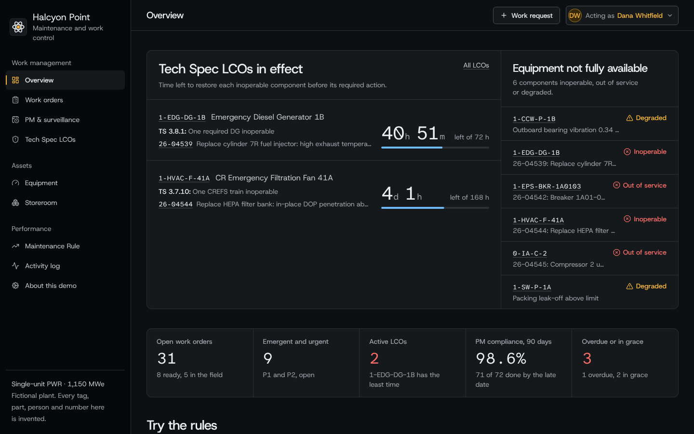
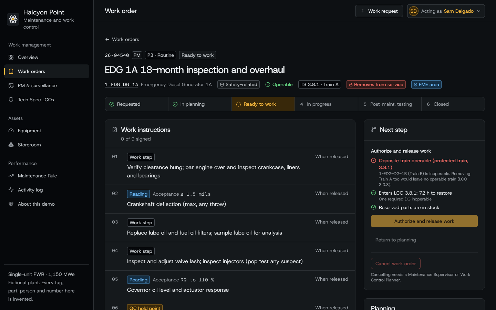
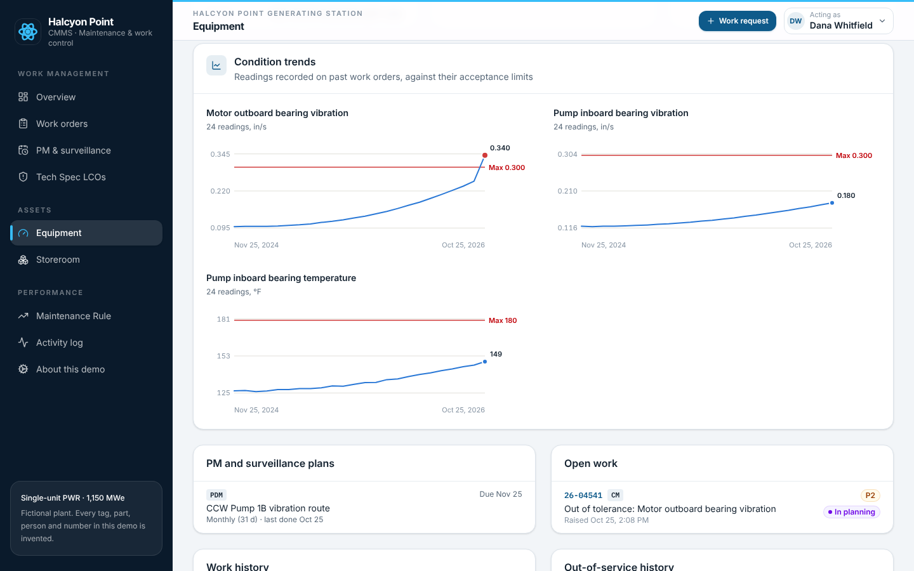
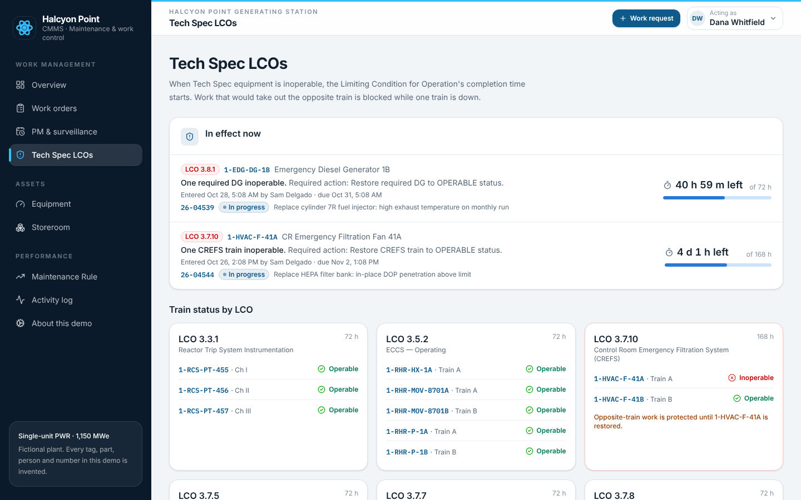
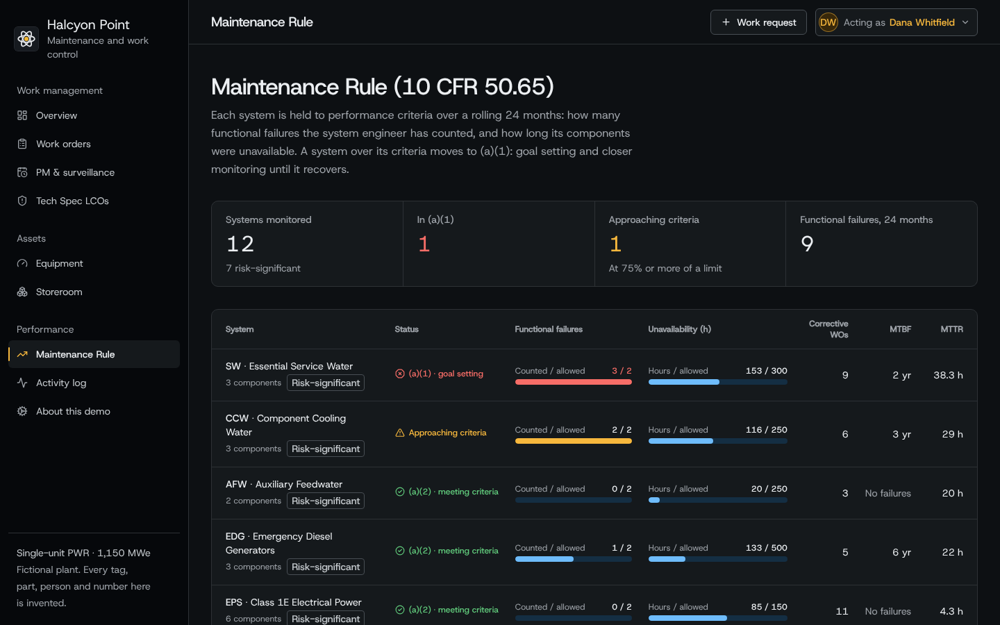

# Halcyon Point CMMS: maintenance management for a nuclear plant

[](https://github.com/skylerhall/nuclear-cmms/actions/workflows/ci.yml)

A working computerized maintenance management system (CMMS) for the maintenance and work-control organization of a nuclear power plant. It covers the parts of the job that general-purpose CMMS tools leave to procedures and spreadsheets: Tech Spec LCO clocks, protected trains, surveillance grace periods, QC hold points, Q-level parts and Maintenance Rule (10 CFR 50.65) monitoring.

> **The plant is fictional.** Halcyon Point Generating Station, its equipment tags, parts, people and every number are invented. The rules follow the structure of standard PWR Technical Specifications and common US nuclear maintenance practice, simplified for a demo.



## What it does

**Work orders, end to end.** Requested → screened into planning → package marked ready → released by the Shift Manager (SRO) → field work → post-maintenance testing → closed. Each transition runs a gate checklist on the server, and the dashboard shows the same checklist, so the UI never offers something the server would refuse.

| Rule | How it shows up |
|---|---|
| **Tech Spec LCOs** | Releasing work that takes Tech Spec equipment out of service enters its LCO and starts the completion-time clock (72 h for an EDG, 2 h for a 125 VDC battery). Returning it to service exits the LCO. Clocks count down live on the dashboard. |
| **Protected trains** | While EDG 1B is inoperable, the system refuses to release planned work that would take EDG 1A out too. If every train of an LCO goes down anyway (an emergent failure), LCO 3.0.3 is flagged. |
| **SR 3.0.2 grace** | Surveillances are due at their interval and late at 1.25× it, measured from the last performance. Past the late date the surveillance is missed (SR 3.0.3). Run-hour PMs work the same way on meter readings. |
| **Acceptance criteria** | Readings are checked against their limits when signed. A failed reading raises corrective work. A failed *surveillance* on Tech Spec equipment declares the component inoperable on the spot and starts the LCO clock. |
| **QC hold points and PMT** | Safety-related maintenance can't be marked ready without a QC hold point and a post-maintenance test. Only QC signs hold points. Only the SRO closes work that held equipment out of service, because closing it is an operability declaration. |
| **Q-level parts** | Safety-related work can only reserve Q-level (Appendix B) stock. Parts are reserved in planning, drawn in the field, and unused reservations go back to the storeroom at close. |
| **Maintenance Rule** | The system engineer decides whether corrective work was a functional failure. Failures and out-of-service hours roll up per system against 24-month performance criteria; systems over their criteria show as (a)(1). |
| **Clearances, ALARA, FME** | The tagout boundary hangs at release and clears at work complete, before the PMT. Rad-area work needs a dose estimate. FME and confined-space flags carry through the package. |
| **Condition trending** | Readings from past work (vibration, bearing temperature, insulation resistance, as-found calibration data) are charted against their limits on each component. |
| **Audit trail** | Every sign-off, release, LCO entry and exit, part issue and evaluation is recorded with who and when. |

**Acting as.** The header switches between eight people (planner, supervisor, three technicians, QC inspector, Shift Manager, system engineer), so a visitor can see what each role can and can't do. It stands in for real sign-in.

## Try it in two minutes

The Overview page has four guided scenarios. Each one opens the right work order as the right person:

1. **Protected train.** As the Shift Manager, try to release the EDG 1A 18-month overhaul. It's blocked because EDG 1B is already in its LCO.
2. **Failed surveillance.** As the mechanical tech, record 0.41 in/s on the RHR Pump 1A outboard bearing. The pump goes inoperable, LCO 3.5.2 starts, and corrective work is raised.
3. **Work package gates.** As the planner, try to mark the CCW Pump 1B bearing job ready. It's missing a post-maintenance test. Add one and it passes. (Its equipment page shows the vibration trend that triggered the job.)
4. **Return to service.** Sign the breaker 1A01-03 post-maintenance test as the electrical tech, then close it as the Shift Manager.

**About this demo → Reset demo data** puts everything back.

## Screenshots

**Protected train.** EDG 1B is in its 72-hour LCO, so the Shift Manager can't release work that would also take EDG 1A out of service. The gate checklist on the right is the same check the server runs.



**Condition trending.** CCW Pump 1B's outboard bearing vibration crossed its 0.30 in/s limit on the latest route, which raised the corrective work order shown below the charts.



**Tech Spec LCOs.** Live completion-time clocks, and train status for every LCO.



**Maintenance Rule.** Functional failures and unavailability per system against 24-month performance criteria.



## Run it locally

Requires **Node.js 22.18 or newer**. No database server is needed.

```bash
git clone https://github.com/skylerhall/nuclear-cmms.git
```

```bash
cd nuclear-cmms && npm install
```

```bash
npm run dev
```

Open http://localhost:4200. The fictional plant, with 24 months of history, loads on first start. All seed data is placed relative to today, so LCO clocks and due dates always look current.

```bash
npm test
```

```bash
npm run typecheck
```

The 13 tests cover the lifecycle end to end, LCO entry and exit, the protected-train block, LCO 3.0.3, failed surveillances, ready-gates and Q-level parts, SR 3.0.2 and meter-based due dates, the PM generator's idempotency, Maintenance Rule status changes, role enforcement over HTTP, and password protection.

## Deploy

The app is one Docker container (API, hourly PM generator and dashboard) with a single SQLite file. On any Docker host, build the `Dockerfile` at the repository root, set `DEMO_PASSWORD`, and mount a volume at `/app/data` if you want changes to survive restarts. The app listens on `$PORT` (default 4200) and exposes `GET /healthz`.

On Render: **New → Blueprint**, pick this repository, and Render reads [`render.yaml`](render.yaml). It uses the free plan, which sleeps after 15 idle minutes and re-seeds the fictional plant on every wake-up, which is fine for a portfolio piece. The demo is open by default; add `DEMO_PASSWORD` in the service's Environment tab to lock it.

| Variable | Default | Purpose |
|---|---|---|
| `DEMO_PASSWORD` | *(off)* | Locks the dashboard. Set it on any public copy. |
| `PORT` | `4200` | HTTP port |
| `DATABASE_PATH` | `./data/cmms.db` | SQLite file (auto-created and seeded) |
| `SCHEDULER_ENABLED` | `true` | Runs the PM and surveillance generator at startup and hourly |

## How it's built

```
server/
  engine/workflow.ts     lifecycle actions, gate checks, step sign-off, failed-reading handling
  engine/operability.ts  out-of-service events, LCO clocks, protected trains, LCO 3.0.3
  engine/pm.ts           PM/surveillance due dates and the idempotent generator
  engine/reliability.ts  Maintenance Rule roll-up: functional failures, unavailability, MTBF, MTTR
  db/                    SQLite schema, data access, fictional plant and seeded history
  http/                  JSON API and optional password protection
shared/rules.ts          roles, transitions, SR 3.0.2 math and labels, used by server and dashboard
web/src/                 React dashboard (Vite + Tailwind)
tests/                   node:test suites
```

Stack: Node.js (TypeScript run natively, no server build step), Express, SQLite (`node:sqlite`), React, Tailwind. Charts are hand-built SVG.

## Demo-grade vs production

Production-shaped already: server-enforced gates, role checks on every action, transactions around every change, an append-only audit trail, and due-date rules shared between server and UI.

A real plant would also need: sign-in with per-user accounts and electronic signatures; links to controlled procedures and revisions; integration with the operations log, the corrective action program and the plant's existing CMMS or ERP; risk assessment for work windows (for example 10 CFR 50.65(a)(4)); outage scheduling; and Postgres once there's more than one server.

## License

[MIT](LICENSE)
